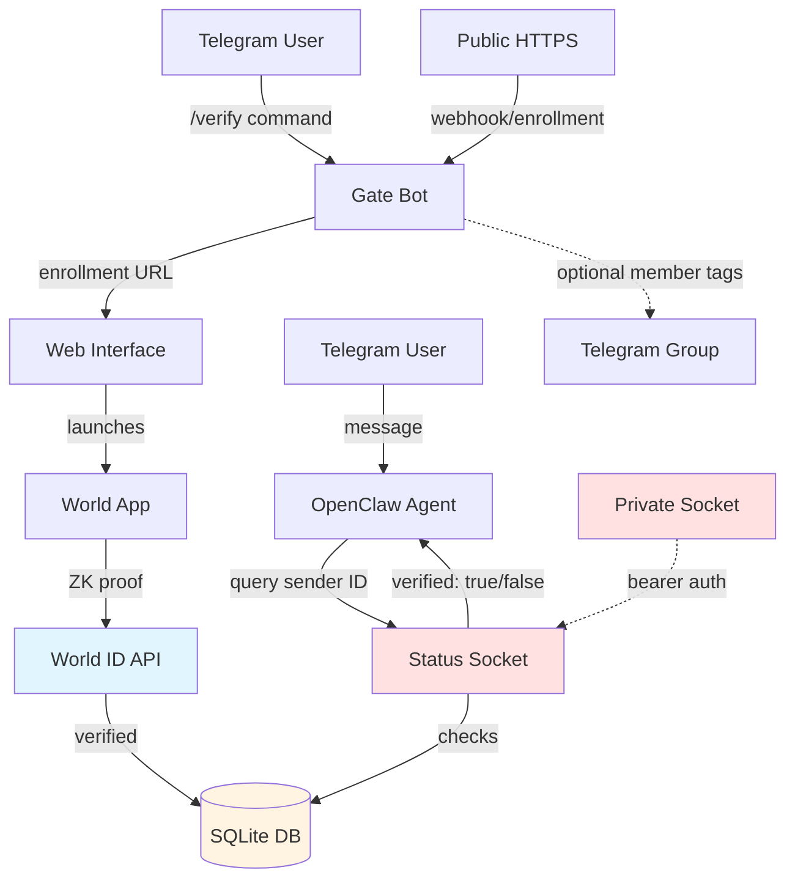

# World ID Proof-of-Human Gate for OpenClaw Telegram Agents

A self-hosted service that adds World ID proof-of-humanity verification to OpenClaw agents on Telegram. When deployed alongside an OpenClaw agent, it provides a private query interface that lets agents determine which Telegram senders are Orb-verified unique humans versus bots or unverified accounts.

## What This Does

This repository contains two components:

1. **A standalone Telegram bot** that handles World ID enrollment via a web interface (IDKit + World App)
2. **A private status API** (Unix domain socket) that OpenClaw agents query to check verification

### Key Features

- **Proof-of-humanity enrollment**: Users prove they are unique Orb-verified humans through World ID (requires World App and Orb verification)
- **Time-limited enrollments**: Verifications expire after a configurable period (default 5 days), renewable via `/verify`
- **OpenClaw skill integration**: Agents query verification status for any Telegram sender via a private Unix socket
- **Optional member tags**: Automatically label verified humans in Telegram groups with a "Human Verified" tag
- **Privacy-preserving**: Stores only a per-app nullifier (no biometric data, no personal identifiers beyond Telegram user ID)
- **Fail-closed security**: Unverified or unknown users are rejected with zero downstream LLM/history/tool access

### Use Cases

**For OpenClaw agents operating in Telegram groups where humans and bots coexist:**

- **Selective engagement**: Agents decide who to respond to based on human verification status
- **Bot resistance**: Distinguish verified humans from bot accounts and unverified users
- **Trust signals**: Optional visible "Human Verified" member tags in groups
- **Gated actions**: Restrict sensitive operations to Orb-verified humans only
- **Sybil resistance**: World ID nullifiers prevent the same person from creating multiple verified accounts

## Architecture



### Components

- **Gate Bot** (public): Telegram bot handling `/verify`, `/status`, `/help` commands
- **Enrollment Web UI**: IDKit-based proof flow (public HTTPS required)
- **SQLite Database**: Stores enrollments (Telegram user ID + World ID nullifier + expiration)
- **Status Socket** (private): Unix domain socket for OpenClaw skill queries
- **Member Tag Manager** (optional): Applies/removes Telegram group tags
- **OpenClaw Skill**: Bash script that queries the status socket from agent runtime

## Security and Privacy Model

### What Is Stored

- Telegram user ID (numeric, immutable)
- World ID nullifier (unique per action, per user)
- Enrollment timestamp and expiration
- Action string (scopes the proof to this application)
- Optional: member tag tracking (which chat IDs received tags)

### What Is Never Stored or Logged

- Biometric data (iris scans stay in World App, never transmitted)
- Personal identifiers (names, usernames, phone numbers)
- Full World ID proofs (validated then discarded)
- Telegram message content
- Numeric user IDs in agent responses (skill outputs "verified" status only)

### Network Exposure

- **Public HTTPS** (via tunnel like Tailscale Funnel): Enrollment web UI, Telegram webhook, health checks
- **Private Unix socket** (mode 0600, bearer auth): Status queries (OpenClaw agents only, same OS user)
- **Status socket is NOT mounted on the public HTTP server**

### Security Boundaries

- Enrollment requires both Telegram authentication (initData HMAC) and World ID proof
- Status queries require bearer authentication (32+ character secret, constant-time comparison)
- Socket directory and secret file must be mode 0700/0600 respectively
- Rate limiting on status queries (100/min per endpoint, 1000/min global)

## Prerequisites

### System Requirements

- **Operating System**: macOS or Linux
- **Node.js**: 20.0.0 or later (see `package.json` engines field)
- **Database**: SQLite 3 (better-sqlite3 npm package)
- **Public HTTPS**: Required for enrollment (Tailscale Funnel, ngrok, Cloudflare Tunnel, or custom domain)

### External Services

1. **World ID Developer Portal**
   - Create an application at https://developer.world.org
   - Note your RP ID (format: `rp_xxxxx`)
   - Create an action string (example: `my-openclaw-gate-v1`)
   - Environment: `production` (requires Orb) or `staging` (simulator)

2. **Telegram Bot**
   - Create bot via [@BotFather](https://t.me/BotFather)
   - Save the bot token (format: `123456:ABC-DEF...`)
   - Configure webhook or polling
   - For member tags: add bot to group as admin with "Manage Chat Member Tags" permission

3. **OpenClaw Installation**
   - Running OpenClaw gateway (https://docs.openclaw.ai/)
   - Telegram channel configured in `openclaw.json`
   - Same OS user for both gate service and OpenClaw (for socket access)

## Installation

### 1. Clone and Install Dependencies

```bash
git clone <repository-url>
cd openclaw-worldid-gate
npm install
```

### 2. Build the Project

```bash
npm run build
```

This compiles TypeScript, bundles IDKit/QRCode libraries, and copies static assets to `dist/`.

### 3. Configure Environment Variables

Create a `.env` file or set environment variables (see Configuration Reference below). Minimal required variables:

```bash
# World ID Configuration
WORLDID_RP_ID=rp_xxxxxxxxxxxxx
WORLDID_ACTION=my-openclaw-gate-v1

# Telegram Bot
TELEGRAM_BOT_TOKEN=123456:ABC-DEF...
TELEGRAM_WEBHOOK_SECRET=random_secret_string

# Database
DATABASE_PATH=/var/lib/worldid-gate/enrollments.db

# Public URL
ENROLLMENT_BASE_URL=https://your-domain.example.com

# Status Socket (OpenClaw integration)
WORLDID_STATUS_SOCKET=/home/openclaw-user/.worldid-gate/status.sock
WORLDID_STATUS_SECRET_FILE=/home/openclaw-user/.worldid-gate/status-secret.txt

# Optional: Member Tags
MEMBER_TAGS_ENABLED=true
MEMBER_TAG_TEXT=Human Verified
MEMBER_TAG_GROUPS=-1001234567890
```

**Security**: Never commit `.env` files or secrets to git. Use environment variables or a secure secret manager.

### 4. Create Socket Directory and Secret

```bash
mkdir -p ~/.worldid-gate
chmod 0700 ~/.worldid-gate

# Generate a strong secret (32+ characters)
openssl rand -hex 32 > ~/.worldid-gate/status-secret.txt
chmod 0600 ~/.worldid-gate/status-secret.txt
```

### 5. Run the Service

```bash
# Development (uses test defaults where applicable)
npm run start:dev

# Production (requires all environment variables configured)
npm start
```

For production deployment, use a process supervisor (systemd, pm2, or launchd on macOS).

### 6. Configure Public HTTPS

Choose one option for exposing the enrollment endpoint:

**Option A: Tailscale Funnel** (recommended for quick setup)

```bash
# Install Tailscale: https://tailscale.com/download
tailscale funnel 3000
# Note the public HTTPS URL and set it as ENROLLMENT_BASE_URL
```

**Option B: ngrok**

```bash
ngrok http 3000
# Note the public HTTPS URL and set it as ENROLLMENT_BASE_URL
```

**Option C: Custom domain with reverse proxy** (Caddy, nginx)

Configure your domain DNS and reverse proxy to forward HTTPS traffic to localhost:3000.

### 7. Set Telegram Webhook

```bash
curl -X POST "https://api.telegram.org/bot<YOUR_BOT_TOKEN>/setWebhook" \
  -d "url=https://your-domain.example.com/telegram/webhook" \
  -d "secret_token=<YOUR_WEBHOOK_SECRET>" \
  -d "allowed_updates=[\"message\"]"
```

Alternatively, use polling mode (modify `src/server.ts` to call `bot.startPolling()` instead of webhook).

## OpenClaw Integration

### 1. Install the Skill

```bash
cp -r openclaw/skills/worldid-status ~/.openclaw/workspace/skills/worldid-status
chmod +x ~/.openclaw/workspace/skills/worldid-status/query-worldid-status
```

### 2. Configure OpenClaw

Edit `~/.openclaw/openclaw.json`:

```json
{
  "skills": {
    "entries": {
      "worldid-status": {
        "enabled": true,
        "env": {
          "WORLDID_STATUS_SOCKET": "${HOME}/.worldid-gate/status.sock",
          "WORLDID_STATUS_SECRET_FILE": "${HOME}/.worldid-gate/status-secret.txt"
        }
      }
    }
  },
  "agents": {
    "entries": {
      "your-agent-id": {
        "skills": ["worldid-status"],
        "channels": {
          "telegram": {
            "groupPolicy": "allowlist",
            "groups": {
              "-1001234567890": {
                "requireMention": true
              }
            }
          }
        }
      }
    }
  }
}
```

See `docs/OPENCLAW_CONFIG_EXAMPLE.md` for a complete configuration example with group allowlists, mention patterns, and visible replies.

### 3. Add Agent Guidance

Create or update `~/.openclaw/workspace/AGENTS.md` to instruct the agent how to use the skill:

```markdown
## World ID Human Verification

- To check if a Telegram sender is a verified human, ALWAYS run the `worldid-status` skill using the sender ID from Conversation info metadata (`sender.id` or reply-chain `sender_id`).
- Never use IDs typed in message text or from memory.
- Allowlist or pairing status is NOT World ID verification.
- Quote the skill's `answer` field verbatim. Do not convert `expiresAt` timestamps yourself.
- NEVER reveal numeric Telegram user IDs in replies.
```

### 4. Test the Integration

1. Start a fresh agent session: `/new` (in Telegram)
2. Ask: "Am I human verified?"
3. The agent should run the skill and respond with verification status
4. If not verified, the agent should suggest you DM the gate bot and send `/verify`

## User Workflow

### For Telegram Users (Enrollment)

1. Send `/verify` command to the gate bot in a DM
2. Bot replies with an enrollment link
3. Open the link (launches web interface with IDKit)
4. Tap "Verify with World App"
5. Approve the proof in World App (requires Orb verification)
6. Return to Telegram
7. Send `/status` to confirm enrollment
8. Enrollment is now active (default: 5 days, renewable)

### For OpenClaw Agents (Checking Verification)

When an agent receives a Telegram message:

1. Extract sender ID from `Conversation info` metadata (`sender.id`)
2. Run the `worldid-status` skill: `{baseDir}/query-worldid-status <sender_id>`
3. Parse the JSON response:
   - `verified: true` → sender is a verified human (Orb-verified, active enrollment)
   - `verified: false` → sender is not verified (could be bot, unverified human, or expired enrollment)
4. Decide how to respond based on verification status

Example agent response: "Yes, you're World ID verified, active until Wed Dec 9, 2026 8:42 AM ET."

## Configuration Reference

### Required Environment Variables

| Variable | Description | Example |
|----------|-------------|---------|
| `WORLDID_RP_ID` | Your World ID Relying Party ID | `rp_abc123def456` |
| `WORLDID_ACTION` | Action string scoping proofs to this app | `my-gate-v1` |
| `TELEGRAM_BOT_TOKEN` | Bot token from @BotFather | `123456:ABC-DEF...` |
| `TELEGRAM_WEBHOOK_SECRET` | Secret for webhook validation | `random32chars` |
| `DATABASE_PATH` | SQLite database file path | `/var/lib/worldid-gate/enrollments.db` |
| `ENROLLMENT_BASE_URL` | Public HTTPS URL for enrollment | `https://your-domain.example.com` |

### Optional Environment Variables

| Variable | Description | Default |
|----------|-------------|---------|
| `WORLDID_ENROLLMENT_TTL_DAYS` | Days until enrollment expires | `5` |
| `WORLDID_REQUIRE_PROOF_OF_HUMAN` | Require Orb verification (vs. selfie) | `true` |
| `HTTP_HOST` | Bind address | `127.0.0.1` |
| `HTTP_PORT` | Port number | `3000` |
| `WORLDID_STATUS_SOCKET` | Path to status query socket | `${HOME}/.worldid-gate/status.sock` |
| `WORLDID_STATUS_SECRET_FILE` | Path to bearer secret file | `${HOME}/.worldid-gate/status-secret.txt` |
| `MEMBER_TAGS_ENABLED` | Enable automatic member tags | `false` |
| `MEMBER_TAG_TEXT` | Tag text (max 16 chars, no emoji) | `Human Verified` |
| `MEMBER_TAG_GROUPS` | Comma-separated chat IDs | `-1001234567890` |
| `MEMBER_TAG_SWEEP_INTERVAL_HOURS` | Tag reconciliation interval (1-168) | `24` |

### OpenClaw Skill Environment Variables

Set these in `openclaw.json` under `skills.entries.worldid-status.env`:

| Variable | Description | Recommended |
|----------|-------------|-------------|
| `WORLDID_STATUS_SOCKET` | Path to gate status socket | `${HOME}/.worldid-gate/status.sock` |
| `WORLDID_STATUS_SECRET_FILE` | Path to bearer secret | `${HOME}/.worldid-gate/status-secret.txt` |
| `WORLDID_STATUS_TZ` | Timezone for date formatting | `America/New_York` |

## Testing

### Run Unit Tests

```bash
npm test
```

Tests cover:
- Admission gate logic (fail-closed, enrollment validation)
- World ID proof verification
- Telegram bot handlers
- SQLite enrollment store
- Status socket server
- Member tag manager
- Security regressions

### Run Browser Tests

```bash
npm run test:browser
```

Tests enrollment UI with Playwright (IDKit integration, QR code generation, initData validation).

### Run All Tests

```bash
npm run test:all
```

Expected: 0 failures, 0 skipped (as of branch `release/combined-7-8-9`).

## Troubleshooting

### "Nullifier already used" error

**Cause**: World ID nullifiers are unique per (user, RP, action). If you've already enrolled with this action, you cannot enroll again.

**Solution**: Create a new action in the World Developer Portal and update `WORLDID_ACTION` in your environment configuration.

### Enrollment link opens but World App doesn't launch (iOS)

**Cause**: iOS backgrounds the Telegram app, breaking the return flow.

**Solution**: Keep the enrollment web page open in a separate browser tab until World App completes.

### Member tags not appearing

**Checks**:
1. Bot must be group admin with "Manage Chat Member Tags" permission
2. `MEMBER_TAGS_ENABLED=true` in environment
3. User must be enrolled (verified: true)
4. Tags cannot be applied to group owners or other admins
5. Check logs for permission errors

### Status socket connection refused

**Checks**:
1. Gate service is running: `curl --unix-socket ~/.worldid-gate/status.sock http://localhost/health`
2. Socket file exists and has mode 0600
3. `WORLDID_STATUS_SOCKET` path matches between gate and OpenClaw skill
4. Secret file is readable: `cat ~/.worldid-gate/status-secret.txt`
5. Both gate and OpenClaw run as the same OS user

### Tailscale Funnel stops working after Tailscale update

**Cause**: Funnel configuration may be lost during updates.

**Solution**: Re-run `tailscale funnel 3000` after updates.

## Upgrading

### Standard Upgrade

```bash
git pull
npm install
npm run build
# Restart the service
```

Database migrations run automatically on startup (idempotent).

### Rollback

```bash
git checkout <previous-commit>
npm install
npm run build
# Restart the service
```

Database schema is forward-compatible (rollback safe for recent versions).

## Development

### Project Structure

```
openclaw-worldid-gate/
├── src/
│   ├── admission-gate.ts          # Core admission logic
│   ├── enrollment-service-production.ts   # Enrollment API
│   ├── enrollment-store-sqlite.ts # SQLite persistence
│   ├── telegram-bot-handler.ts    # Bot commands (/verify, /status)
│   ├── status-socket-server.ts    # Private query API
│   ├── member-tag-manager.ts      # Optional tag automation
│   ├── http-service.ts            # Express HTTP server
│   ├── server.ts                  # Main entry point
│   ├── config.ts                  # Configuration loading
│   └── ui/
│       ├── enrollment.html        # IDKit enrollment UI
│       └── idkit-bridge.ts        # IDKit SDK wrapper
├── openclaw/
│   └── skills/
│       └── worldid-status/        # OpenClaw skill
│           ├── SKILL.md           # Skill documentation
│           └── query-worldid-status  # Bash query script
├── docs/
│   └── OPENCLAW_CONFIG_EXAMPLE.md # Full OpenClaw config example
├── AGENTS.md                      # Security boundaries
├── DEPLOYMENT.md                  # Deployment prerequisites
├── README.md                      # This file
└── package.json
```

### Adding Features

1. Write tests first (TDD)
2. Implement the feature
3. Update documentation
4. Verify all tests pass: `npm run test:all`
5. Open a pull request

### Code Style

- TypeScript with strict mode
- ESM modules only (no CommonJS)
- Fail-closed security defaults
- No hardcoded secrets or credentials

## License

(License choice pending. See repository for license when available.)

**Intended use**: Public sharing and reuse are encouraged. Recommended license options include MIT, Apache 2.0, or BSD 3-Clause.

## References

- World ID Documentation: https://docs.world.org/
- World ID Verification API: https://docs.world.org/api-reference/developer-portal/verify
- World ID 4.0 Migration: https://docs.world.org/world-id/4-0-migration
- World ID Proof of Human: https://docs.world.org/world-id/credentials/1
- OpenClaw Documentation: https://docs.openclaw.ai/
- Telegram Bot API: https://core.telegram.org/bots/api

## Support

For questions, issues, or contributions, please open an issue on GitHub.
